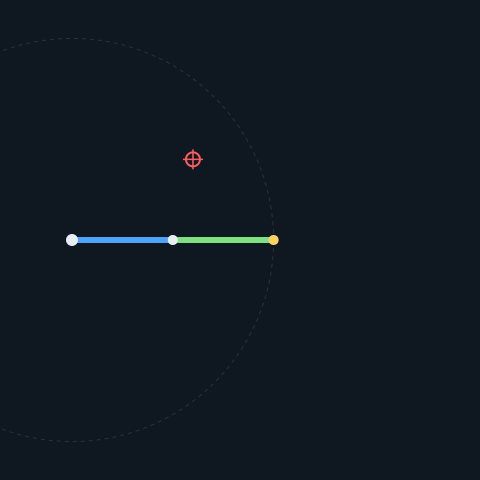
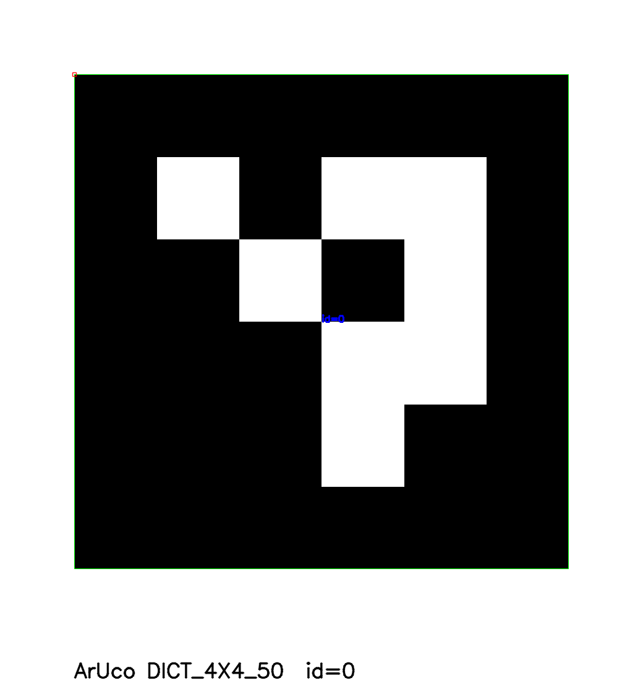
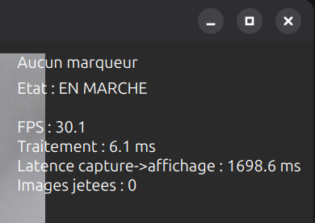
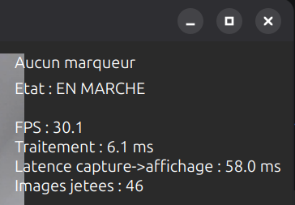

# projet_bras_robotique

Un bras robotique de table qui **suit un objet en mouvement lent, prédit sa trajectoire et
l'intercepte**. Le cœur — cinématique, perception, prédiction, coordination — est écrit en
**C++20**, testé et outillé. C'est du code, pas de la configuration de firmware tiers : la
valeur est dans les algorithmes et dans l'architecture temps réel.



## Statut

| Phase | Contenu | État |
|-------|---------|------|
| **0** | Lib de cinématique FK/IK, CMake, tests, sanitizers, démo animée | ✅ |
| **1** | Perception : calibration caméra, détection ArUco, pose 3D métrique | ✅ |
| **1.5** | IHM de supervision Qt : flux, pose, télémétrie, pause, arrêt d'urgence | ✅ |
| 2 | Un bras physique, cible statique (calibration main-œil, canal PC → MCU) | En cours (2.0) |
| 3 | Suivi temps réel en boucle fermée | À venir |
| 4 | Anticipation : prédire la trajectoire et intercepter | À venir |
| 5 | Deuxième bras et passe d'objet | À venir |

## Phase 0 — Cinématique

Une bibliothèque `kinematics` pour un bras plan, et une démo qui la donne à voir.

- **Cinématique directe** — `forward_kinematics(arm, angles)` : chaque segment est une
  transformation homogène 2D (rotation puis translation le long de l'axe local). On chaîne
  les matrices depuis la base et on lit la pose de l'effecteur dans la colonne de translation.
- **Cinématique inverse** — `inverse_kinematics_2link(l1, l2, x, y, elbow)` : résolution
  analytique. L'angle du coude vient de la **loi des cosinus**, son signe distingue les deux
  solutions (coude haut / bas), l'épaule vaut `atan2(y, x) − atan2(l2·sin θ₂, l1 + l2·cos θ₂)`.
  Une cible hors de la couronne `|l1 − l2| ≤ d ≤ l1 + l2` renvoie `std::nullopt` : une
  absence de solution, pas une erreur.
- Les tests d'IK ne figent aucun angle : ils vérifient la **propriété**
  `forward_kinematics(inverse_kinematics(cible)) == cible`, la bonne façon de tester une
  fonction à solutions multiples.

## Phase 1 — Perception

De la webcam à une position 3D en mètres.

- **`calibrate`** — calibration des intrinsèques (matrice `K` + distorsion) sur une mire
  9×6 (`docs/chessboard_9x6.png`), coins affinés au sous-pixel. Erreur de reprojection
  obtenue : **0,19 px**. Le résultat est écrit dans `camera_intrinsics.yml`, propre à chaque
  caméra et donc non versionné.
- **`aruco_detect`** — détection de marqueurs `DICT_4X4_50` avec l'API `cv::aruco::ArucoDetector`
  (OpenCV ≥ 4.7).
- **`pose_estimate`** — pose 3D du marqueur par `cv::solvePnP` (`SOLVEPNP_IPPE_SQUARE`).
  Distance **validée au réglet** à 30 cm et 60 cm.
- **Lib `perception`** — le calcul est sorti des applications dans une bibliothèque testée :
  `load_intrinsics`, `estimate_marker_pose` (pur calcul, 4 coins → pose) et
  `MarkerDetector::detect(image)`. Le dessin reste dans les applications : la lib ne dépend
  pas de `highgui` et tournera sans écran. Les tests vérifient la pose par aller-retour
  projection → estimation, et `detect()` sur une image synthétique où la distance attendue
  se calcule à la main (`z = f · L / s`).



> **Le piège d'échelle.** Une seule caméra ne voit qu'une taille apparente : un petit objet
> proche et un grand objet lointain donnent la même image. C'est la **taille réelle du
> marqueur** qui donne l'échelle métrique, et elle désigne le **côté extérieur complet du
> carré noir**, coin à coin, pas un de ses modules internes. Une erreur sur cette longueur
> multiplie toutes les distances par le même facteur. On l'a diagnostiquée en vérifiant que
> le rapport `distance affichée / distance réelle` restait constant à deux distances, la
> signature d'une erreur d'échelle plutôt que de décalage.

## Phase 1.5 — Supervision Qt

`qt_supervisor` : le flux annoté (marqueurs, axes 3D), la pose, la télémétrie, et les
commandes Pause, **Arrêt d'urgence** et Réarmer. L'essentiel est dans l'architecture des
threads.

**Perception → GUI : signaux *queued*.** La capture, la détection et la pose tournent dans
un `QThread` dédié, pour ne jamais bloquer la boucle d'événements qui dessine. Le worker ne
touche aucun widget : il émet des signaux, et comme émetteur et récepteur vivent dans des
threads différents, Qt copie les arguments et exécute le slot sur le thread GUI. L'image est
convertie en `QImage` par **copie profonde** (la copie d'un `cv::Mat` partage son buffer), et
les types maison (`MarkerPose`, `Telemetry`) sont enregistrés avec `qRegisterMetaType`.

**GUI → perception : des atomiques, pas des slots.** Le worker tourne dans une boucle et ne
revient jamais lire sa file d'événements : un slot *queued* comme `pause()` ne s'exécuterait
jamais. Les commandes écrivent donc directement des `std::atomic<bool>`, lus à chaque tour de
boucle. L'arrêt d'urgence est **verrouillé** : seul un réarmement volontaire le lève. Il
complète un arrêt d'urgence matériel, il ne le remplace pas.

**Cycle de vie et erreurs.** Les intrinsèques sont chargées dans `main()` puis injectées
dans le worker : un fichier manquant s'affiche avant même le démarrage du thread. Une caméra
introuvable remonte par signal jusqu'à une boîte de dialogue, puis l'application se ferme
avec un code d'erreur : une IHM qui laisse croire qu'on peut encore agir est pire qu'une IHM
fermée. Le thread et le worker sont des objets locaux de `main()` (RAII) : un `deleteLater`
déclenché par l'arrêt prématuré du thread provoquait un *use-after-free*, détecté par
AddressSanitizer sur ce chemin d'erreur.

**Une seule image en vol.** Si la GUI affiche moins vite que la caméra ne produit, chaque
signal empile une image de plus dans sa file : la latence et la mémoire croissent sans
limite. Le worker n'émet donc une image que si la précédente a été affichée
(`std::atomic<bool>::exchange`), sinon il la jette. Mesure avec un affichage ralenti
volontairement à 50 ms par image (`--slow-gui`), caméra à 30 FPS :

| | Sans la garde | Avec la garde |
|---|---|---|
| Latence capture → affichage | 1 699 ms, croissante | **58 ms, stable** |
| Images jetées | 0 | ~10 par seconde |

<p>
  
  
</p>

## Architecture

```
include/kinematics/    API publique de la lib de cinématique
include/perception/    API publique de la lib de perception (intrinsèques, pose, détecteur)
src/                   implémentation (planar_arm, inverse_kinematics, markers)
tests/                 tests unitaires Catch2
app/                   exécutables : arm_demo, camera_view, calibrate, aruco_detect, pose_estimate
app/qt_supervisor/     IHM de supervision (worker de perception + fenêtre Qt)
docs/                  mires, marqueur, captures et démo
```

Les libs `kinematics` et `perception` sont du calcul pur, sans affichage ni matériel :
elles se testent entièrement hors cible. Les headers privés d'un exécutable vivent à côté de ses sources ; seule l'API
publique d'une bibliothèque va dans `include/`.

## Prérequis

- Compilateur C++20 (GCC ≥ 12), CMake ≥ 3.20, Ninja.
- [vcpkg](https://github.com/microsoft/vcpkg) avec `VCPKG_ROOT` positionné : Eigen et
  Catch2 sont déclarés dans `vcpkg.json` et installés à la configuration.
- **OpenCV ≥ 4.7** et **Qt 6**, installés par le système (`libopencv-dev`, `qt6-base-dev`).
  Sans eux, la lib et les tests se construisent quand même ; les cibles vision et IHM sont
  simplement ignorées.
- `clang-format` (optionnel) pour les cibles de formatage.

## Construire, tester, lancer

```bash
cmake --preset vcpkg
cmake --build --preset vcpkg
ctest --preset vcpkg                       # 18 tests (11 sans OpenCV)

./build/arm_demo 1.2 0.8 arm_demo.svg      # Phase 0 : animation de l'IK
./build/calibrate                          # Phase 1 : produit camera_intrinsics.yml
./build/pose_estimate                      # Phase 1 : pose 3D du marqueur
./build/qt_supervisor                      # Phase 1.5 : supervision
./build/qt_supervisor --slow-gui           # idem, affichage ralenti pour tester la latence
```

Les programmes de vision lisent `camera_intrinsics.yml` dans le dossier courant : lance-les
depuis la racine du dépôt.

## Qualité

- `-Wall -Wextra -Wpedantic -Werror` sur toutes les cibles ; AddressSanitizer / UBSan
  disponibles (`-DENABLE_SANITIZERS=ON`).
- CI GitHub Actions : build Debug, build ASan/UBSan, tests, vérification du formatage.
- Style imposé par `.clang-format` :
  `cmake --build --preset vcpkg --target format` reformate,
  `--target format-check` vérifie sans rien modifier.

## Limites connues

- La CI ne compile pas encore la perception ni l'IHM (il faut une image avec OpenCV ≥ 4.7
  et Qt 6) : les 7 tests de `perception` ne tournent qu'en local.
- La taille du marqueur est en dur dans deux applications, en attendant un fichier de
  configuration de scène.
- Webcam intégrée en 640×480 : la portée de détection est limitée, et l'éclairage doit
  rester maîtrisé (une ombre franche sur une mire casse la détection).

Le périmètre complet et le plan par phases sont dans `BRIEF-projet-bras-robotique.md`.
